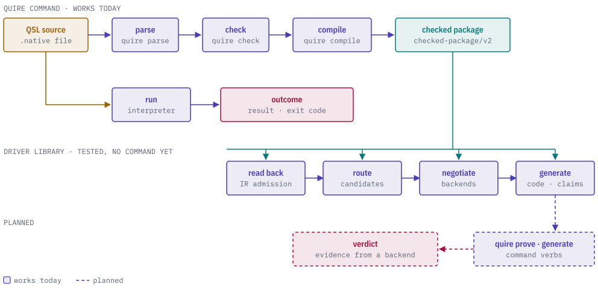

# quire-driver

[](https://discord.gg/k8DVhuYBR2)
[](https://github.com/agent-ix/quire-spec-language)

quire-driver is the `quire` command-line tool and the Rust library behind it.
It runs a QSL specification from source to result.

It reads the source, has QSL check and package the rule, passes the checked
package to Contract IR and the code generators, and reports the result with one
exit code. It is the only component that calls both QSL and the code
generators.

<picture>
  <source media="(prefers-color-scheme: dark)" srcset="docs/images/hero-dark.svg">
  
</picture>

## Getting started

quire-driver is built from source. Install a Rust toolchain at least as new as
the `rust-version` in `Cargo.toml`, then install the `quire` binary using the
repository's locked dependencies:

```
cargo install --git https://github.com/agent-ix/quire-driver --locked quire-cli
```

To install from a local checkout instead:

```
git clone https://github.com/agent-ix/quire-driver
cd quire-driver
cargo install --path quire-cli --locked
```

Check the install with `quire --version`.

## Commands

The binary is built from the `quire-cli` package. Its verbs follow the QSL
command-line design:

| Verb | State | What it does |
| --- | --- | --- |
| `parse`, `check`, `compile`, `run` | works | Run the QSL stage of that name on one source file and print QSL's result document. Use `--format json`. |
| `format` | works | Print the source in QSL's canonical layout. |
| `analyze`, `monitor`, `prove`, `replay`, `generate`, `inspect`, `render` | planned | Recognized, and end as `unsupported` (exit 21) until a handler is written. |

`run` accepts `--engine interpreter|aot|jit` and `--limit` overrides. The
interpreter is the linked engine, and the other engines are refused before
anything runs. The command supplies an empty object environment.

Every command ends with QSL's own exit code, passed through unchanged:

| Exit code | Meaning |
| --- | --- |
| 0 | success |
| 10 | violation or undefined |
| 20 | refused |
| 21 | unsupported |
| 22 | incomplete or inconclusive |
| 30 | internal failure |

### Example

This source defines one function that always returns true:

```
language "ix:native" edition "1-draft";
profile v = "quire.value.complete/v1";
function yes using v(): Boolean pure { true }
```

Save it as `yes.qsl` and run the function. The command exits with code 0:

```
quire run yes.qsl yes --format json
```

## Library

The `quire-driver` library crate exposes `drive`, which runs one request
through the stages below. QSL owns the language and the generators own code
generation, and the driver is the one place that joins them.

1. Parse, select, check and package the source with QSL, sharing one `Cancel`
   handle. The result is the `checked-package/v2` bytes and their identity.
2. Read those bytes back through Contract IR's reader. The package it admits
   carries the identity QSL just emitted.
3. Write the items to negotiate from the package's own checked requirement
   records, one per record. A unit with no scalar operation application has no
   records, so nothing is routed and nothing is generated.
4. Convert every registered backend to the code generator's backend kind. An
   id with no kind refuses the run before any negotiation, naming each one.
5. Negotiate with the backend providers, then route the items settled as
   supported.
6. Ask the code generator to generate for each routed item and return its
   settlements, claim map and generated artifacts.

The registry of backends is a value the caller builds from provider manifests
and passes in.

`execute` is the smaller entry point behind `quire run`: it compiles one
source and calls one function on the selected engine, returning QSL's typed
outcome unchanged.

## Crates

| Crate | Role |
| --- | --- |
| `quire-driver` (root) | The library: `drive`, `execute`, the registry, limits and the cache interface. Depends on QSL and the code generator. |
| `quire-cli` | The `quire` binary: argument parsing and the command handlers. Depends on the driver and the cache. |
| `quire-plugin-host` | The process boundary for out-of-process backend providers: framing, wire types and lifecycle for the `quire.plugin-wire/v1` protocol. |
| `quire-cache` | A content-addressed on-disk cache that implements the driver's cache interface. |

The driver defines the cache interface and the cache implements it, so the
library never depends on its own cache.

## Quire ecosystem

<picture>
  <source media="(prefers-color-scheme: dark)" srcset="docs/images/ecosystem-dark.svg">
  
</picture>

quire-driver sits above the main chain and runs it. It
depends on the QSL layer crates from
[quire-spec-language](https://github.com/agent-ix/quire-spec-language),
on [quire-contract-codegen](https://github.com/agent-ix/quire-contract-codegen),
on the model crate of
[quire-contract-ir](https://github.com/agent-ix/quire-contract-ir), and on
[quire-canonical](https://github.com/agent-ix/quire-canonical) and
[quire-exact](https://github.com/agent-ix/quire-exact). No QSL, IR or
code-generator crate depends on it. It also uses `ix-cli-kit` for the
command-line exit and stream conventions.

## Building and testing

```
make fmt-check   # formatting
make lint        # clippy, warnings are errors
make test        # cargo test
make deny        # license and source policy
make spec        # quire validate over spec/
make ci          # every gate above plus doc checks
```

`make build` makes a release build. Requirements live in
[`spec/`](spec/spec.md).

## Contributing

Contributions are welcome under the contributor license agreement. See
[CONTRIBUTING.md](CONTRIBUTING.md) and [CLA.md](CLA.md).

## License

AGPL-3.0-or-later. See [LICENSE](LICENSE).
