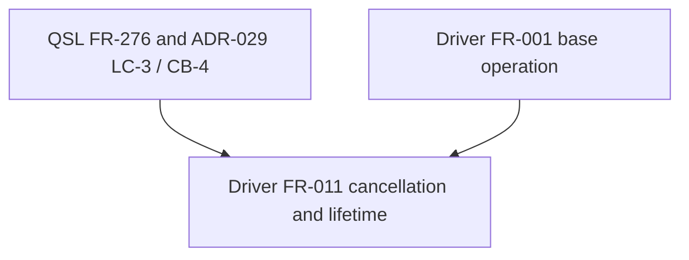

## Summary

The scoped dependency order is acyclic: the driver operation in FR-001 is the existing base, FR-011 adds caller-owned cancellation/source lifetime to it, and QSL ADR-029/FR-276 supply the upstream cancellation contract. No missing prerequisite edge was found that blocks specification work.

## Findings

| ID | Severity | Summary | Refs |
| --- | --- | --- | --- |
| FND-001 | low | No dependency cycles or unowned upstream contract dependencies were found in the reviewed slice. | FR-001, FR-011 |

## Classification and Order

| Requirement | Class | Rationale |
| --- | --- | --- |
| FR-001 | Feature / driver core | Existing compile-and-drive operation being extended. |
| FR-011 | Feature / driver library boundary | Adds caller cancellation and source-lifetime behavior over FR-001 and QSL's typed lifecycle. |

## Dependency Graph

The formal FR-011 relationship to FR-001 is currently `references`; its body describes extending FR-001's compile path. That is sufficient as a descriptive relation for this spec slice, though implementation planning should keep FR-001 before FR-011.
